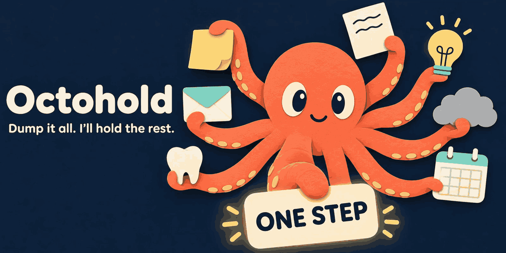

<p align="center">
  
</p>

<h1 align="center">🐙 Octohold</h1>
<p align="center"><b>Dump it all. I'll hold the rest.</b><br>
A free AI skill for busy, scattered, ADHD brains.</p>

<p align="center">
  
  
  
</p>

---

## ⚡ 10-second version

| | |
|---|---|
| 🗣️ **1. Dump** | Type or say *everything* in your head. Any order. Messy is fine. |
| 🪞 **2. Mirror** | Claude plays it back, sorted, on **one screen**. |
| ✅ **3. Check** | *"Did I get this right?"* Fix anything. Nothing gets planned until you say yes. |
| 👣 **4. One step** | You get **one** small step. Octohold holds the rest. |

<p align="center"></p>

---

## 📦 Install (30 seconds)

### 🥇 Easiest: paste this link into your AI agent

Works in **Claude Code, Codex, Qwen Code, QwenWork, Kiro, Gemini CLI, Cursor, GitHub Copilot** and any agent that can run commands:

```text
Install this skill: https://github.com/Chinchuan24/octohold
```

Your AI reads this page and installs it itself. ✅

### 🧩 Or one command for all your AI tools at once

```bash
npx skills add Chinchuan24/octohold -g
```

<sub>Uses the open-source <a href="https://github.com/vercel-labs/skills">skills</a> installer. It finds every AI tool you have and installs Octohold into each one.</sub>

### 🗺️ Works everywhere

| AI | How to add Octohold |
|---|---|
| 🟠 **Claude Code** | `git clone https://github.com/Chinchuan24/octohold ~/.claude/skills/octohold` |
| 🟠 **Claude app** (web / desktop) | Download [`octohold.zip`](https://github.com/Chinchuan24/octohold/releases/latest) → **Settings → Skills** → upload |
| 🟢 **ChatGPT** (Business, Enterprise, Edu) | Download the ZIP → **Skills** → upload |
| 🟢 **ChatGPT** (Free / Plus) | Paste [`PROMPT.md`](PROMPT.md) into **Custom Instructions**, or `SKILL.md` into a **Project** |
| 🟢 **Codex** | `git clone https://github.com/Chinchuan24/octohold ~/.agents/skills/octohold` |
| ⚫ **Grok** | Download the ZIP → **Skills** → upload (accepts `.zip` or `.md`) |
| 🟣 **Qwen Code** / **QwenWork** | `git clone https://github.com/Chinchuan24/octohold ~/.qwen/skills/octohold`, or paste the link (see 🥇) |
| 🟡 **Kiro** | `git clone https://github.com/Chinchuan24/octohold ~/.kiro/skills/octohold` |
| 🔵 **Gemini CLI** | `git clone https://github.com/Chinchuan24/octohold ~/.gemini/skills/octohold` |
| 🔵 **Gemini app** | Paste [`PROMPT.md`](PROMPT.md) or `SKILL.md` into a **Gem** |
| ⚪ **Cursor** | `git clone https://github.com/Chinchuan24/octohold ~/.cursor/skills/octohold` |
| ⚪ **GitHub Copilot** | `git clone https://github.com/Chinchuan24/octohold ~/.copilot/skills/octohold` |
| ❓ **Anything else** | Paste [`PROMPT.md`](PROMPT.md) into its custom instructions |

> ✅ **Nothing to block it.** No plugin, no scripts, no dependencies, no internet calls. It follows the open [Agent Skills](https://agentskills.io) standard: one text file.
>
> 🔄 Restart your AI app after installing.

---

## 🎬 Use it

Just start dumping. Any of these will wake it up:

- *"brain dump"*
- *"let me get this out of my head…"*
- a long, rambly voice note
- or type **`/octohold`**

---

## 👀 What it looks like

> **You:** ok rent due friday haven't moved money. reply to Priya re offsite. dentist keep forgetting. half-written blog post. maybe learn pottery. honestly feel behind on everything

> **Octohold:**
> 👉 **Check I heard you right.**
> ☑️ Move rent money (due Fri) · Reply to Priya · Book dentist
> 📁 Blog post (half-written)
> 💡 Learn pottery
> 💭 Feeling behind on everything
> 👂 "Priya", or did I mishear the name?
> ✅ yes, go · ✏️ fix something

> **You:** yes but it's Maya not Priya

> **Octohold:**
> 👉 **Open your banking app and move the rent money.** It's the only hard deadline.
> Fixed: reply to **Maya**.
> 📥 Holding the rest. Pottery stays an idea, not a task.

<p align="center"></p>

---

## 💛 Why it feels different

| Octohold… | So you… |
|---|---|
| 🪞 checks it understood **before** planning | never get a plan built on a misunderstanding |
| 👣 shows **one** step, not a list of 20 | can actually start |
| 💭 keeps feelings as feelings | don't get "feel behind" turned into a task |
| 👂 flags words voice typing may have misheard | don't email the wrong person |
| ✂️ shrinks a step once, then tries a new way | don't get stuck in "too big" |
| ⏸️ stops all pressure when you say "pause" | can just breathe |

---

## 🔒 What it will never do

- ❌ Send, post or schedule anything
- ❌ Promise reminders or remember chats it can't see
- ✅ Only writes **one** file per dump: `~/brain-dumps/<date>.md`, so you can come back later

---

## 🙏 Credits

Built on two great MIT skills:
- [brain-dump](https://github.com/TheCraigHewitt/skills) by Craig Hewitt, for sorting
- [adhd-brain-dump](https://github.com/yuchenbigpen1/donna-skills) by Donna, for one step at a time

Details in [`NOTICE.md`](NOTICE.md). **MIT license: free forever, for everyone.** 🐙

---

<details>
<summary>🤖 <b>For AI assistants installing this skill</b></summary>

If someone pasted this repo link and asked you to install it:

1. Pick **your own** skills folder:
   - Claude Code → `~/.claude/skills/octohold`
   - Codex → `~/.agents/skills/octohold`
   - Qwen Code / QwenWork → `~/.qwen/skills/octohold`
   - Kiro → `~/.kiro/skills/octohold`
   - Gemini CLI → `~/.gemini/skills/octohold`
   - Cursor → `~/.cursor/skills/octohold`
   - GitHub Copilot → `~/.copilot/skills/octohold`
   - Not sure → `~/.agents/skills/octohold`
2. If that folder doesn't exist, run `git clone https://github.com/Chinchuan24/octohold <folder>`.
   If it exists, update it with `git -C <folder> pull --ff-only`.
3. Tell them: "✅ Octohold installed. Restart, then say *brain dump* to try it."

No other steps. No scripts to run. No git? Download `SKILL.md` into that folder instead.
</details>
